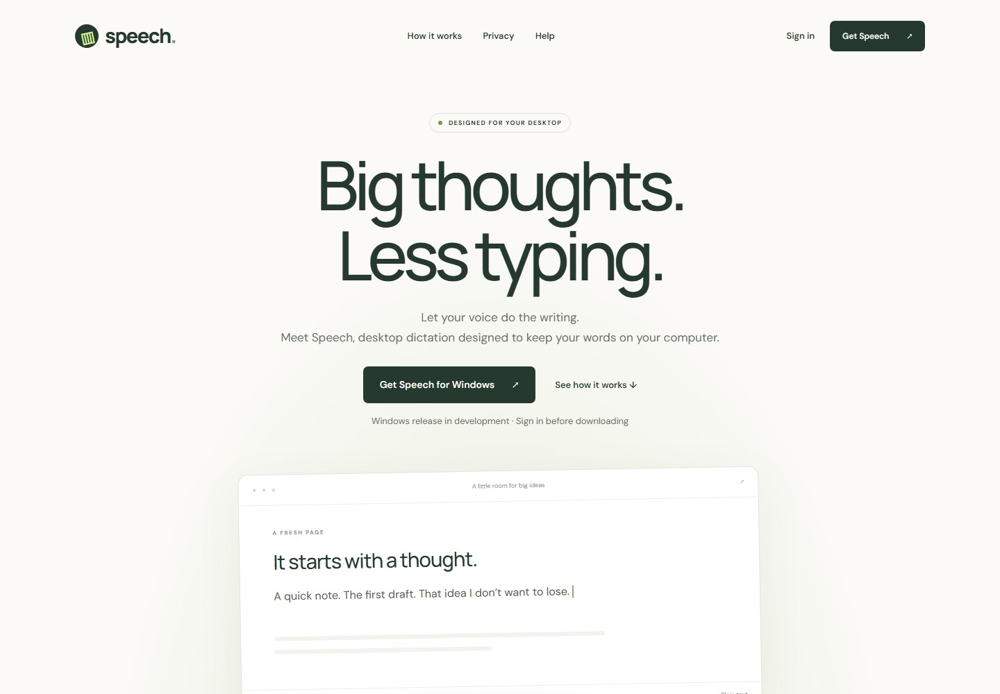
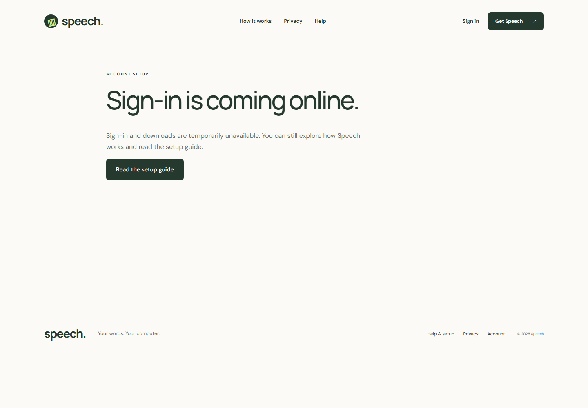
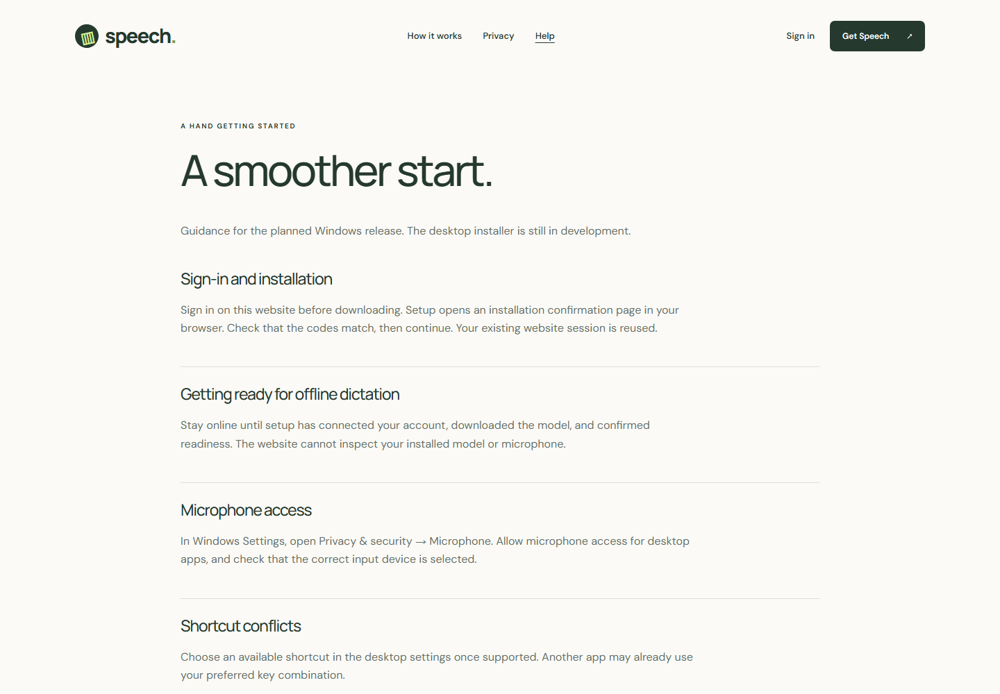
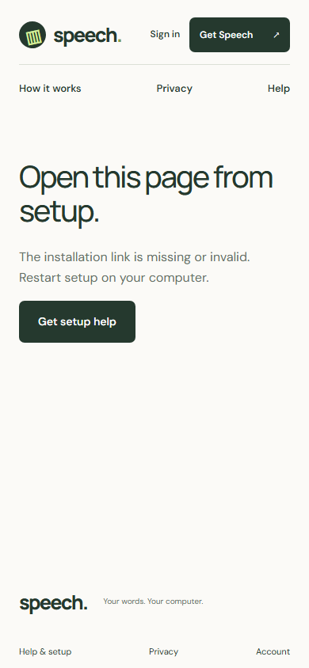

# Speech product review

Reviewed 2026-10-19 using the Product Design audit workflow. Scope: public website → protected download entry → help; mobile navigation and invalid installation recovery. Goal: understand local dictation and start installation through website authentication.

## Verdict

The public pages are coherent and usable. This is a partial onboarding review, not a release-readiness approval: real Clerk sign-in, authenticated downloads, account details and installation approval could not be exercised without configured credentials and an installer. Backend source was not changed.

Fresh screenshots were captured from the local production build at 1440×1000 and 390×844. Initial development captures with loading overlays were rejected and replaced. Each accepted screenshot was opened and inspected. Original evidence is in this folder; verified fixes are in `after/`.

## 1. Desktop landing — healthy, readability improved

Clear headline and Windows CTA, with release status immediately below. The original 10px release-status text made an important limitation easy to overlook; increased to 13px. The demo disclosure increased from 9px to 12px. The simulated demo remains distinct from real microphone input.

## 2. Download entry — safely blocked; live sign-in unverified

The download CTA reaches an unavailable-account state when Clerk keys are absent. No installer or bypass is exposed. The original screen had no prominent next action and described environment configuration; changed to user-facing availability copy and a setup-guide action. Real Clerk redirects and downloaded artifact integrity remain untested.

## 3. Help — healthy within the reviewed viewport

Readable headings explain setup, offline readiness, microphone access and shortcut conflicts. Copy distinguishes planned desktop behavior from current website functionality. The initial viewport is captured here; this does not constitute an audit of every desktop troubleshooting scenario.

## 4. Mobile entry — navigation corrected

The original mobile header hid both sign-in and primary navigation. Restored sign-in and a compact second navigation row for workflow, privacy and help. Header and footer links now have at least 44px height. Main copy and buttons fit the captured 390px viewport; automated reflow checks also cover desktop and mobile.

## 5. Invalid installation link — recovery improved

The page explains that setup must generate the link, with no fabricated approval state. Added a prominent setup-help action instead of leaving the user with only an instruction and footer links. An expired real transaction and successful code approval still need live API validation.

## Remaining verification

- Configure the frontend and backend for the same Clerk application and dynamic JWT email claim. Test actual sign-in, session expiry and authenticated account access.
- Publish a signed installer and test the full browser confirmation and installer exchange. Website approval alone must never imply desktop activation completed.
- Test screen-reader announcements, keyboard traversal, 200% zoom, contrast measurements and additional devices. Screenshots and current automation do not establish WCAG compliance.
- The chosen Figma file remained inaccessible. Visual fidelity to that template was not assessed; the user authorized independent design decisions.

No database, backend middleware or backend route code was changed during this review.
